# Desarrollo de un modelo predictivo basado en redes neuronales para la predicción dinámica a corto plazo de la concentración de fosfato en una planta de tratamiento de aguas residuales

Documento de métodos, resultados y discusión de la tesis. Todas las cifras se generan con los scripts del repositorio ([README principal](../README.md)). Las figuras están en [`figuras/`](../figuras/) (PNG, 300 dpi, sin título interno) y las tablas en [`resultados/tablas/`](../resultados/tablas/).

**Contenido**
1. [Métodos](#1-métodos)
2. [Resultados](#2-resultados)
3. [Discusión de resultados](#3-discusión-de-resultados)
4. [Conclusiones](#4-conclusiones)
5. [Referencias](#5-referencias)
6. [Anexo: índice de figuras](#anexo-índice-de-figuras)

---

# 1. Métodos

## 1.1 Esquema general de la investigación

La investigación siguió siete etapas, desde la obtención de los datos SCADA hasta el análisis de robustez y explicabilidad del modelo (Figura 1). Cada etapa corresponde a un script del repositorio, que se ejecuta en el orden indicado.

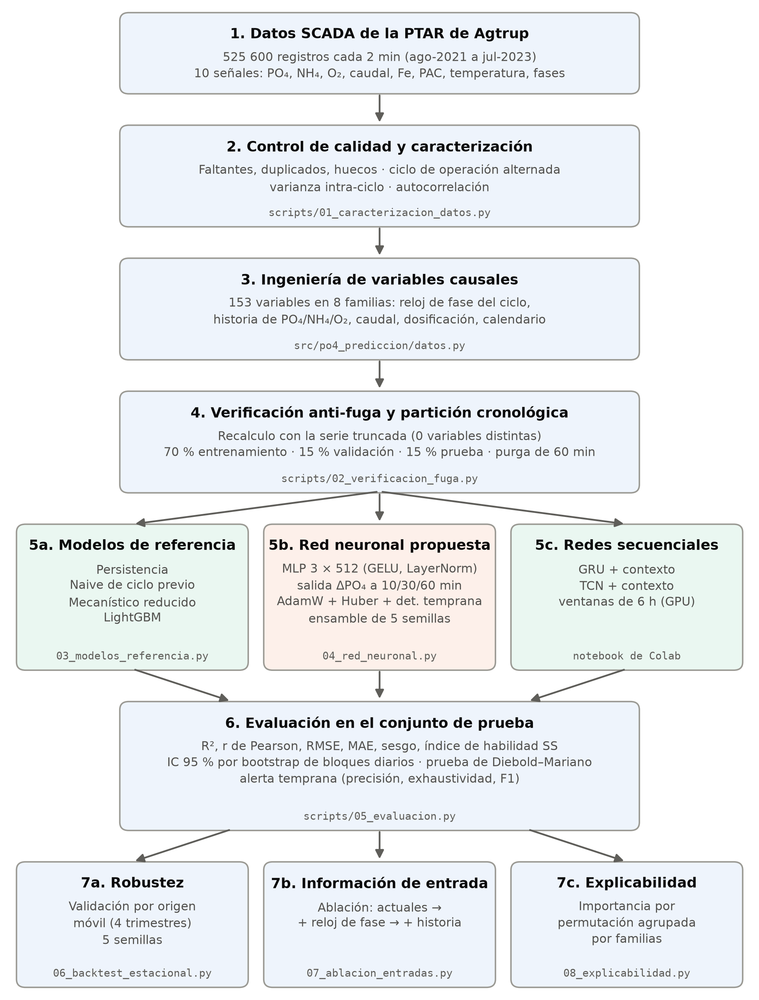

*Figura 1. Diagrama metodológico de la investigación. Debajo de cada etapa se indica el script que la implementa.*

El protocolo para obtener las métricas de validación (Figura 2) se diseñó para evitar cualquier uso de información futura:
- la partición es cronológica;
- los hiperparámetros y la detención temprana se deciden solo con entrenamiento y validación;
- el conjunto de prueba se usa una única vez.

Sobre las predicciones de prueba se calcularon métricas puntuales, intervalos de confianza y pruebas de significancia. Además se evaluó la robustez temporal (cuatro trimestres) y frente a la inicialización (cinco semillas).

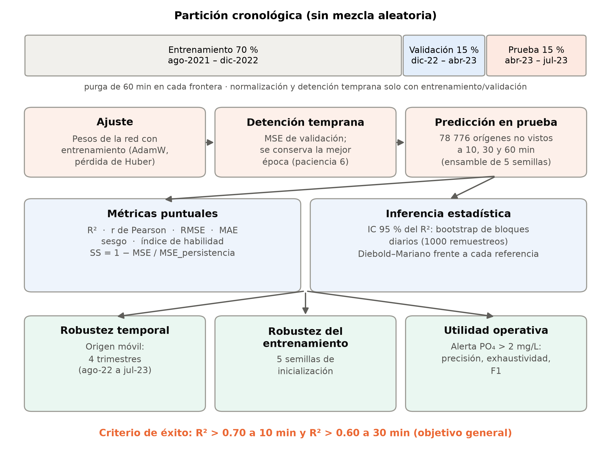

*Figura 2. Protocolo de validación temporal y obtención de las métricas.*

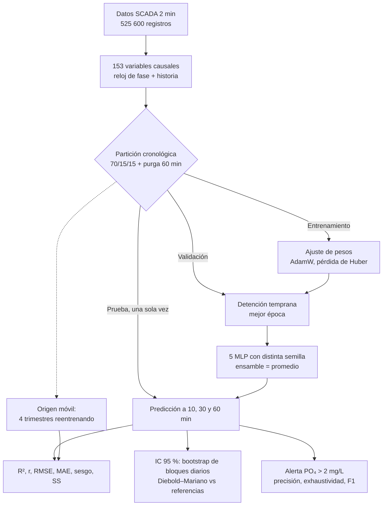

## 1.2 Fuente de datos

- **Origen.** Se usó el conjunto público *Wastewater Treatment Plant Data for Nutrient Removal System* (Mohammadi et al., 2024). Proviene del sistema SCADA de la PTAR de Agtrup (BlueKolding, Kolding, Dinamarca; 125 000 habitantes equivalentes), que remueve fósforo por vía biológica y química.
- **Tamaño.** Son 525 600 registros cada 2 min, entre el 1 de agosto de 2021 y el 31 de julio de 2023.
- **Variable objetivo.** `T1_PO4`, la concentración de fosfato medida en línea en el tanque biológico 1 (mg/L).
- **Variables auxiliares:**
  - amonio (`T1_NH4`) y oxígeno disuelto (`T1_O2`);
  - caudal afluente (`IN_Q`);
  - dosificación de hierro (`IN_METAL_Q`) y de PAC (`METAL_Q`);
  - temperatura;
  - señal de capacidad (`MAX_CF`);
  - fases de entrada y salida de la operación alternada (`PROCESSPHASE_INLET/OUTLET`).

## 1.3 Entorno computacional

| Elemento | Detalle |
|---|---|
| Lenguaje | Python 3.12 |
| Librerías | PyTorch 2.13 (redes neuronales), LightGBM 4.7, scikit-learn 1.9, SciPy 1.18, pandas 3.0, NumPy 2.5, Matplotlib 3.11 |
| Gestión del entorno | uv (`pyproject.toml` y `uv.lock` fijan las versiones exactas) |
| Hardware | CPU de 16 núcleos para todo el pipeline; GPU NVIDIA T4 (Google Colab) solo para GRU y TCN |
| Reproducibilidad | Semillas fijas (42, 7, 123, 2024, 31415); código en el repositorio Git |

## 1.4 Descripción del código

El código se organiza en un módulo reutilizable (`src/po4_prediccion/`) y nueve scripts que se ejecutan en orden (`scripts/`). La Tabla 1 resume cada archivo; a continuación se describe su función. Para la tesis puede pegarse el contenido de cada archivo enlazado.

*Tabla 1. Archivos de código de la investigación.*

| Archivo | Función | Salidas |
|---|---|---|
| [`src/po4_prediccion/datos.py`](../src/po4_prediccion/datos.py) | Carga de datos, 153 variables causales, reloj de fase, particiones | — (módulo) |
| [`src/po4_prediccion/red_neuronal.py`](../src/po4_prediccion/red_neuronal.py) | Arquitectura MLP y procedimiento de entrenamiento | — (módulo) |
| [`src/po4_prediccion/referencias.py`](../src/po4_prediccion/referencias.py) | Persistencia, naive de ciclo previo, modelo mecanístico, LightGBM | — (módulo) |
| [`src/po4_prediccion/metricas.py`](../src/po4_prediccion/metricas.py) | R², r, RMSE, MAE, sesgo, SS, bootstrap, Diebold–Mariano | — (módulo) |
| [`scripts/01_caracterizacion_datos.py`](../scripts/01_caracterizacion_datos.py) | Calidad del registro y caracterización del ciclo | `01_*.csv` |
| [`scripts/02_verificacion_fuga.py`](../scripts/02_verificacion_fuga.py) | Prueba de ausencia de información futura | `02_verificacion_fuga.csv` |
| [`scripts/03_modelos_referencia.py`](../scripts/03_modelos_referencia.py) | Entrenamiento de los modelos de referencia | `03_parametros_mecanistico.csv` |
| [`scripts/04_red_neuronal.py`](../scripts/04_red_neuronal.py) | Entrenamiento de las 5 MLP y del ensamble | `04_*.csv`, modelos `.pt` |
| [`notebooks/redes_secuenciales_gru_tcn_colab.ipynb`](../notebooks/redes_secuenciales_gru_tcn_colab.ipynb) | GRU y TCN en GPU | `resultados/colab/` |
| [`scripts/05_evaluacion.py`](../scripts/05_evaluacion.py) | Métricas, IC 95 %, Diebold–Mariano, alerta temprana | `05_*.csv` |
| [`scripts/06_backtest_estacional.py`](../scripts/06_backtest_estacional.py) | Validación por origen móvil (4 trimestres) | `06_*.csv` |
| [`scripts/07_ablacion_entradas.py`](../scripts/07_ablacion_entradas.py) | Ablación de la información de entrada | `07_ablacion_entradas.csv` |
| [`scripts/08_explicabilidad.py`](../scripts/08_explicabilidad.py) | Importancia por permutación agrupada | `08_importancia_familias.csv` |
| [`scripts/09_figuras.py`](../scripts/09_figuras.py) | Figuras de la tesis | `figuras/*.png` |

**`datos.py`: preparación de datos e ingeniería de variables.**
- Lee el CSV y lo ordena cronológicamente.
- Construye el **reloj de fase** de la operación alternada: un ciclo comienza cuando la fase de entrada pasa de 1 a 2. Para cada instante calcula:
  - la fase actual;
  - los pasos transcurridos desde el último cambio de fase;
  - la duración de las fases y del ciclo anteriores;
  - la posición y la fracción del ciclo.
- Genera además la historia de PO₄ (rezagos de 2 a 180 min, estadísticos móviles de 10 min a 24 h, derivadas y valor en la misma posición del ciclo anterior), la historia de NH₄ y O₂, el caudal, la dosificación química y el calendario.
- Todas las variables son **causales**: en el instante t solo usan datos con tiempo ≤ t.
- Define la partición cronológica 70/15/15, con una purga de 30 pasos (60 min) en cada frontera, y las particiones trimestrales de la validación por origen móvil.

**`red_neuronal.py`: red neuronal propuesta.**
- Define el perceptrón multicapa: 3 capas ocultas de 512 neuronas, cada una con normalización de capa (LayerNorm), activación GELU y dropout de 0.10.
- La salida tiene 3 neuronas lineales: el cambio ΔPO₄ a 10, 30 y 60 min.
- Las entradas y salidas se estandarizan con los estadísticos de entrenamiento.
- El entrenamiento usa AdamW (tasa máxima 2·10⁻³, decaimiento de pesos 10⁻⁴) con programación OneCycle y lotes de 4096, minimizando la pérdida de Huber.
- La detención temprana conserva los pesos de la época con menor MSE de validación (paciencia de 6 épocas).

**`referencias.py`: modelos de comparación.**
- La persistencia, ŷ(t+h) = y(t).
- El naive de ciclo previo: el valor observado en la misma posición del ciclo anterior.
- LightGBM sobre el cambio ΔPO₄, con detención temprana en validación.
- El **modelo mecanístico reducido** (sección 1.7).

**`metricas.py`: evaluación.** Implementa las métricas de la sección 1.8, el bootstrap de bloques móviles y la prueba de Diebold–Mariano.

**Scripts 01 a 09.**
- `01` caracteriza el registro y el ciclo operacional.
- `02` verifica la ausencia de fuga de información: recalcula las variables con la serie truncada en cuatro puntos y las compara con las de la serie completa.
- `03` ajusta los modelos de referencia.
- `04` entrena las cinco MLP y forma el ensamble.
- `05` evalúa todos los modelos en el conjunto de prueba.
- `06` repite el entrenamiento en cuatro trimestres consecutivos.
- `07` ejecuta la ablación de la información de entrada.
- `08` calcula la importancia por familias de variables.
- `09` genera las figuras.
- El notebook entrena en GPU las redes secuenciales GRU y TCN de comparación.

## 1.5 Variables de entrada

*Tabla 2. Familias de variables de entrada (153 en total).*

| Familia | Contenido | N.º |
|---|---|---|
| PO₄ actual | `T1_PO4(t)` | 1 |
| Historia de PO₄ | Rezagos de 1 a 90 pasos; media, máximo y mínimo móviles (10 min – 24 h); desviación móvil; derivadas; pasos desde la última actualización del sensor; valor en la misma posición del ciclo anterior | 63 |
| Fase y reloj del ciclo | Fases de entrada y salida; pasos desde el último cambio de fase; duración de las fases y del ciclo anteriores; posición y fracción del ciclo; estado de aireación; fase rezagada | 18 |
| NH₄ | Actual, rezagos, medias móviles, derivada, valor del ciclo anterior | 20 |
| O₂ disuelto | Actual, rezagos, medias móviles | 18 |
| Caudal y carga hidráulica | Caudal actual, rezagos y medias móviles; `MAX_CF` | 13 |
| Dosificación química | Fe a biología y PAC al decantador; sumas móviles | 14 |
| Temperatura y calendario | Temperatura; hora del día y estacionalidad anual (seno y coseno); día de la semana | 6 |

## 1.6 Partición de los datos y validación temporal

*Tabla 3. Partición cronológica.*

| Conjunto | Desde | Hasta | Orígenes |
|---|---|---|---|
| Entrenamiento (70 %) | 01-ago-2021 | 25-dic-2022 | 367 604 |
| Validación (15 %) | 25-dic-2022 | 13-abr-2023 | 78 760 |
| Prueba (15 %) | 13-abr-2023 | 31-jul-2023 | 78 776 |

No se usó mezcla aleatoria. Las etiquetas que cruzaban una frontera se purgaron. Como validación adicional, se reentrenaron los modelos en cuatro trimestres consecutivos (ago-2022 a jul-2023). En cada caso se usaron todos los datos previos para entrenar y los 30 días anteriores al trimestre para la detención temprana.

## 1.7 Modelo mecanístico reducido

Un ASM2d completo requiere el PO₄ afluente, los volúmenes, los sólidos y la biomasa PAO, que no están disponibles. Por eso se formuló un balance de primer orden inspirado en sus mecanismos de liberación y captación, con cinética distinta según la fase:

$$\frac{dS_{PO_4}}{dt}=k_m\left(S^*_m-S_{PO_4}\right),\qquad S^*_m=b_m\,\overline{S}_{PO_4,3h}+c_m,\qquad m\in\{\text{alimentación},\ \text{sin alimentación}\}$$

- El calendario de fases futuro se proyecta de forma causal con la duración de las últimas fases. Acierta la fase a +30 min el 75.1 % de las veces, frente al 41.7 % si se supone que la fase actual continúa.
- Se integra con pasos de Euler de 2 min.
- Los 6 parámetros se ajustan por mínimos cuadrados con datos de entrenamiento.

## 1.8 Métricas de evaluación

Con y como el valor observado, ŷ el predicho y n el número de predicciones:

| Métrica | Expresión | Interpretación |
|---|---|---|
| Coeficiente de determinación | $R^2 = 1-\dfrac{\sum(y-\hat y)^2}{\sum(y-\bar y)^2}$ | Fracción de la varianza explicada (meta del objetivo general) |
| Correlación de Pearson | $r=\dfrac{\mathrm{cov}(y,\hat y)}{\sigma_y\sigma_{\hat y}}$ | Grado de asociación lineal |
| Raíz del error cuadrático medio | $RMSE=\sqrt{\tfrac{1}{n}\sum(y-\hat y)^2}$ | Error típico (mg/L), penaliza errores grandes |
| Error absoluto medio | $MAE=\tfrac{1}{n}\sum\lvert y-\hat y\rvert$ | Error promedio (mg/L) |
| Sesgo | $\tfrac{1}{n}\sum(\hat y-y)$ | Sobre- o subestimación sistemática |
| Índice de habilidad | $SS = 1-\dfrac{MSE_{modelo}}{MSE_{persistencia}}$ | Mejora relativa frente a la persistencia |

**Inferencia estadística.**
- **IC 95 % del R².** Se obtuvo por bootstrap de bloques móviles: 1000 remuestreos de bloques de un día (720 orígenes), lo que preserva la autocorrelación temporal.
- **Comparación entre modelos.** Se usó la prueba de Diebold–Mariano con pérdida cuadrática y varianza de Newey–West (rezago igual al horizonte).

**Alerta temprana.** Se evaluó la detección de PO₄ > 2 mg/L mediante precisión, exhaustividad (*recall*) y F1.

---

# 2. Resultados

## 2.1 Caracterización de los datos

**Calidad del registro.** No hay valores faltantes, fechas duplicadas ni huecos temporales, por lo que no fue necesaria ninguna imputación. El PO₄ tiene una media de 0.68 mg/L, una mediana de 0.45 mg/L y un percentil 95 de 2.01 mg/L.

**Cambio de régimen.** El periodo de validación (invierno de 2023) tiene concentraciones menores (media de 0.39 mg/L) y coincide con la suspensión casi total de PAC (Figuras 3 y 7).

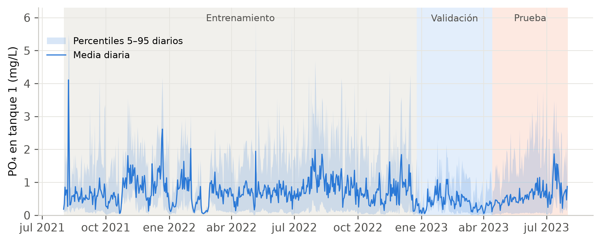

*Figura 3. Concentración de PO₄ en el tanque 1 (media y percentiles 5–95 diarios) y partición cronológica.*

**El ciclo de operación alternada (Figuras 4 y 5).**
- El afluente ingresa al tanque 1 en fases discretas. En cada alimentación, el PO₄ y el NH₄ suben juntos, y descienden durante la fase siguiente.
- El PO₄ alcanza su máximo al ~15 % del ciclo y su mínimo al ~60 %.
- La duración mediana mensual del ciclo varía entre 66 min (verano) y 142 min (invierno).
- **El 46.6 % de la varianza total de PO₄ ocurre dentro de cada ciclo.**

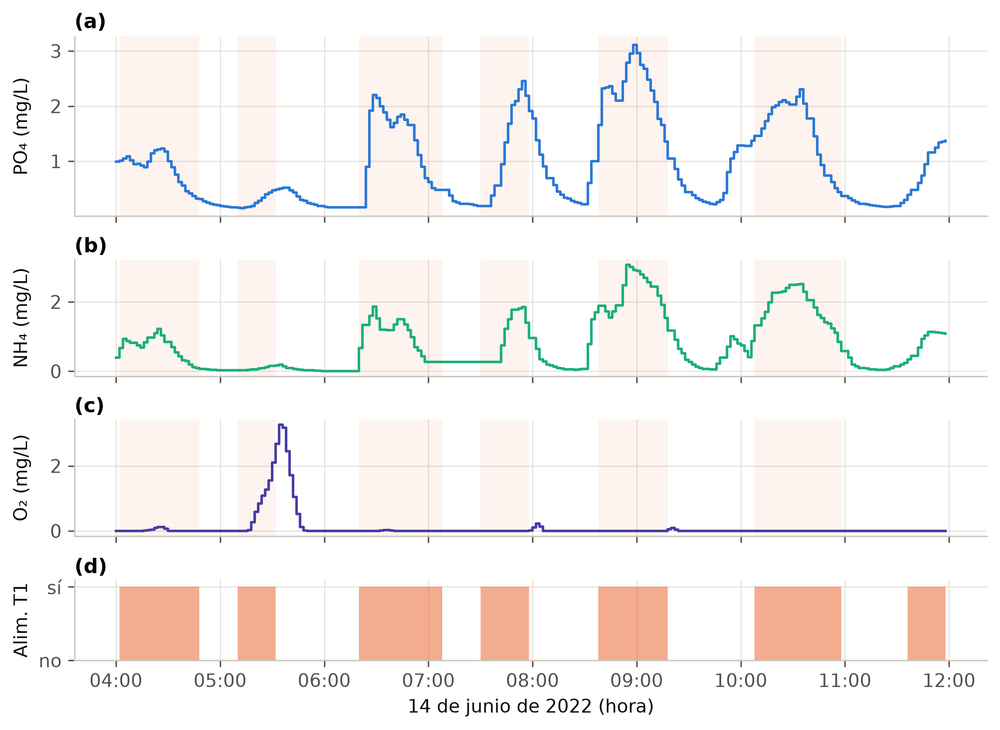

*Figura 4. Ventana de 8 h de operación: (a) PO₄, (b) NH₄, (c) O₂ disuelto y (d) fase de alimentación del tanque 1.*

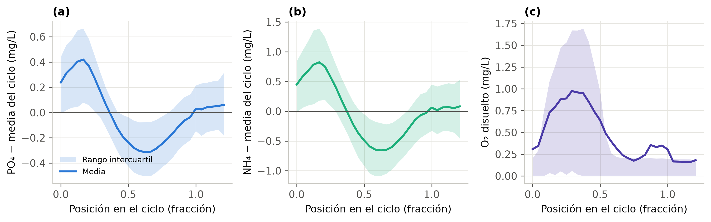

*Figura 5. Perfiles medios intra-ciclo (con rango intercuartil) de (a) PO₄, (b) NH₄ y (c) O₂.*

**Consecuencia para la predicción (Figura 6).** La autocorrelación de PO₄ baja de 0.85 a 10 min a 0.48 a 30 min y alcanza un mínimo de 0.34 a 50 min. El valor actual pierde rápidamente capacidad predictiva por la periodicidad del ciclo.

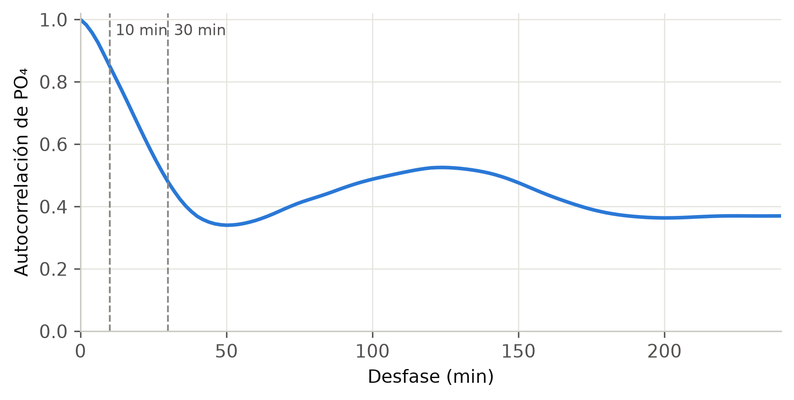

*Figura 6. Autocorrelación de PO₄ entre 0 y 240 min.*

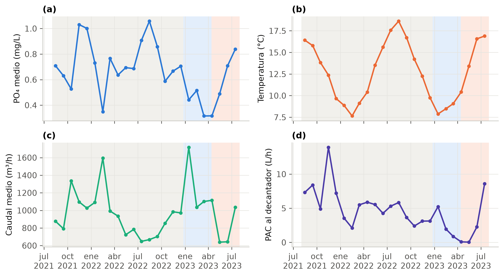

*Figura 7. Condiciones mensuales: (a) PO₄, (b) temperatura, (c) caudal y (d) dosificación de PAC.*

## 2.2 Verificación de la ausencia de fuga de información

Se recalcularon las 153 variables con la serie truncada en 100 000, 250 123, 400 007 y 500 001 registros. En los cuatro casos, **0 variables** difirieron de las calculadas con la serie completa. Ninguna variable de entrada usa información futura.

## 2.3 Entrenamiento de la red neuronal

- Las cinco redes se detuvieron entre las épocas 11 y 20 (15.6 ± 3.6). Su mejor época de validación estuvo entre la 5 y la 14 (Figura 8).
- El MSE de validación es menor que el de entrenamiento por dos razones: el error de entrenamiento se mide con *dropout* activo, y el periodo de validación tiene menor variabilidad de PO₄.

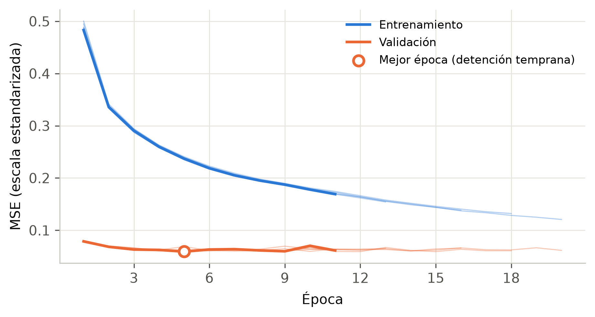

*Figura 8. Curvas de entrenamiento y validación de la MLP. En línea gruesa la semilla 42; en líneas tenues las otras cuatro.*

## 2.4 Desempeño frente a las metas del objetivo general

*Tabla 4. Desempeño en el conjunto de prueba (78 776 predicciones por horizonte). RMSE y MAE en mg/L.*

| Modelo | R² 10 min [IC 95 %] | r | RMSE | MAE | SS | R² 30 min [IC 95 %] | r | RMSE | MAE | SS |
|---|---|---|---|---|---|---|---|---|---|---|
| Persistencia | 0.510 [0.42, 0.58] | 0.76 | 0.487 | 0.297 | 0.00 | −0.442 [−0.65, −0.26] | 0.28 | 0.835 | 0.593 | 0.00 |
| Naive de ciclo previo | 0.222 [0.07, 0.34] | 0.66 | 0.613 | 0.350 | −0.59 | 0.183 [0.04, 0.30] | 0.59 | 0.628 | 0.362 | 0.43 |
| Mecanístico reducido | 0.574 [0.50, 0.63] | 0.76 | 0.454 | 0.298 | 0.13 | 0.310 [0.22, 0.39] | 0.56 | 0.578 | 0.398 | 0.52 |
| LightGBM | 0.814 [0.78, 0.84] | 0.90 | 0.300 | 0.165 | 0.62 | 0.711 [0.67, 0.75] | 0.85 | 0.374 | 0.226 | 0.80 |
| GRU + contexto | 0.832 [0.80, 0.86] | 0.91 | 0.285 | 0.158 | 0.66 | 0.718 [0.67, 0.76] | 0.85 | 0.369 | 0.221 | 0.80 |
| TCN + contexto | 0.834 [0.81, 0.86] | 0.91 | 0.283 | 0.160 | 0.66 | 0.711 [0.66, 0.75] | 0.85 | 0.374 | 0.224 | 0.80 |
| **MLP propuesta (ensamble)** | **0.822 [0.79, 0.85]** | **0.91** | **0.293** | **0.157** | **0.64** | **0.720 [0.67, 0.76]** | **0.85** | **0.368** | **0.213** | **0.81** |
| *Meta* | *> 0.70* | | | | | *> 0.60* | | | | |

**Resultado principal.**
- La red neuronal propuesta alcanza **R² = 0.822 a 10 min** y **R² = 0.720 a 30 min**. Supera ambas metas del objetivo general, y también lo hacen los límites inferiores de sus IC 95 % (0.790 y 0.669) (Figura 9).
- Frente a la persistencia, reduce el RMSE un 40 % a 10 min y un 56 % a 30 min.
- El índice de habilidad (SS) es de 0.64 y 0.81 respectivamente.

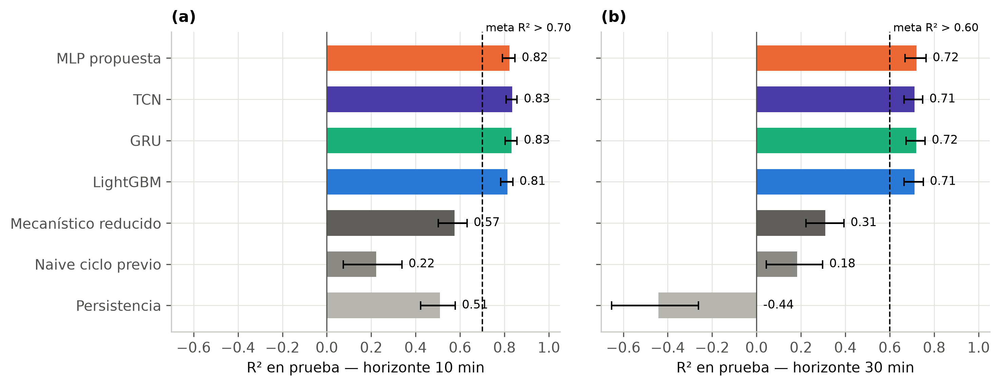

*Figura 9. R² en prueba de todos los modelos a (a) 10 min y (b) 30 min, con IC 95 %. La línea discontinua indica la meta del objetivo general.*

**Calidad de ajuste (Figuras 10 a 12).**
- Las predicciones se agrupan en torno a la línea 1:1 (r = 0.91 a 10 min y 0.85 a 30 min).
- La red anticipa la subida y la bajada de cada ciclo, mientras que la persistencia queda desfasada media fase a 30 min.
- Los errores están centrados en cero: el sesgo es de −0.024 mg/L a 10 min y −0.003 mg/L a 30 min.

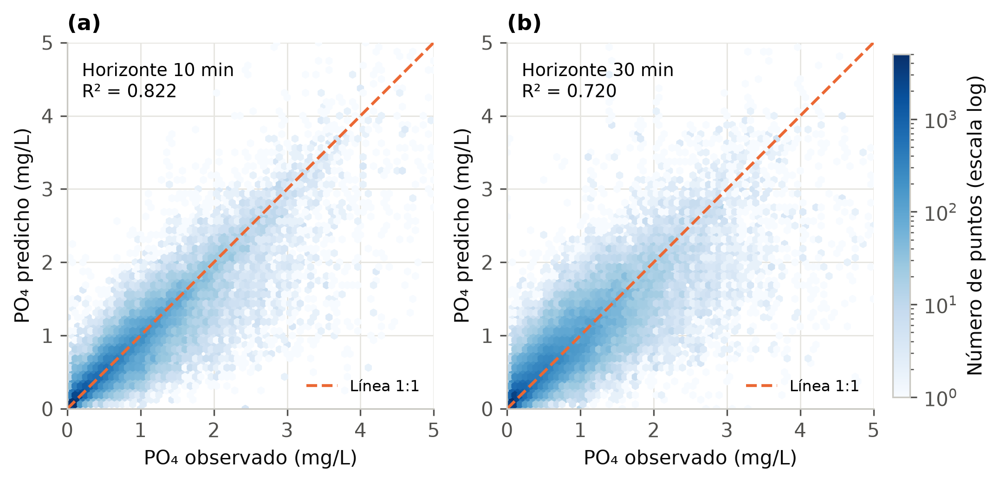

*Figura 10. PO₄ observado frente a predicho por la red propuesta a (a) 10 min y (b) 30 min.*

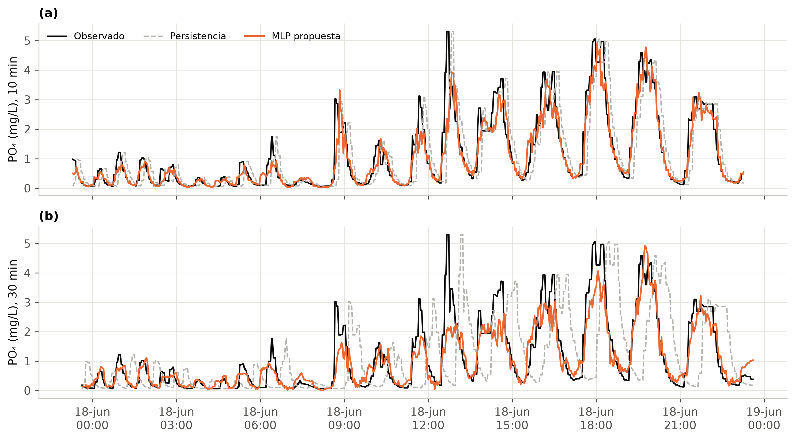

*Figura 11. Serie de prueba (24 h de mayor variabilidad): observado, persistencia y red propuesta a (a) 10 min y (b) 30 min.*

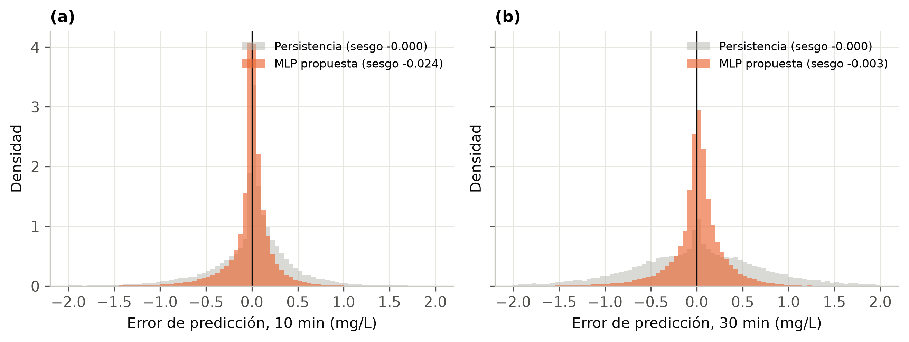

*Figura 12. Distribución de los errores de predicción.*

**Efecto del horizonte (Figura 13).**
- El R² de las redes neuronales disminuye de forma suave y monótona: ≈0.95 a 2 min, ≈0.81 a 10 min, ≈0.71 a 30 min y ≈0.50 a 60 min.
- La persistencia cae por debajo de R² = 0 a partir de unos 20 min, cuando el reactor pasa a la fase opuesta del ciclo.

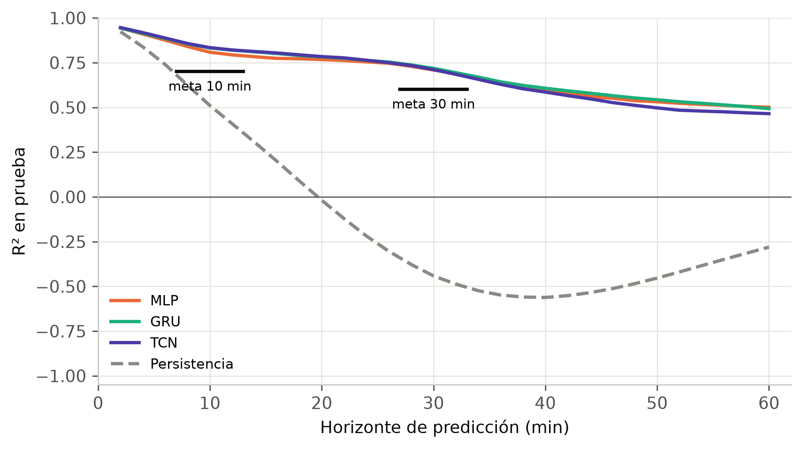

*Figura 13. R² en prueba en función del horizonte (2–60 min) para las tres redes neuronales y la persistencia.*

## 2.5 Significancia estadística

*Tabla 5. Diferencia de R² entre la red propuesta y cada modelo (bootstrap) y prueba de Diebold–Mariano.*

| Comparación | ΔR² 10 min [IC 95 %] | p | ΔR² 30 min [IC 95 %] | p |
|---|---|---|---|---|
| vs Persistencia | +0.317 [0.266, 0.369] | < 0.001 | +1.179 [1.012, 1.341] | < 0.001 |
| vs Naive de ciclo previo | +0.608 [0.504, 0.724] | < 0.001 | +0.544 [0.462, 0.630] | < 0.001 |
| vs Mecanístico reducido | +0.252 [0.212, 0.291] | < 0.001 | +0.414 [0.361, 0.459] | < 0.001 |
| vs LightGBM | +0.008 [0.003, 0.014] | < 0.001 | +0.009 [−0.006, 0.024] | 0.076 |
| vs GRU | −0.010 [−0.015, −0.007] | < 0.001 | +0.002 [−0.011, 0.011] | 0.629 |
| vs TCN | −0.012 [−0.021, −0.004] | < 0.001 | +0.010 [−0.002, 0.021] | 0.066 |

- La red propuesta supera a la persistencia, al naive de ciclo previo y al modelo mecanístico con p < 0.001 en ambos horizontes.
- A 30 min es estadísticamente equivalente a LightGBM, GRU y TCN (p > 0.05). Ninguna arquitectura supera a la red propuesta en ese horizonte.
- A 10 min supera a LightGBM. Las redes secuenciales obtienen 0.01 más de R², una diferencia de magnitud práctica despreciable (RMSE 0.283 frente a 0.293 mg/L). Además, una GRU o una TCN tarda entre 8 y 40 veces más en entrenar que una MLP individual.

## 2.6 Robustez de los resultados

**Inicialización (Figura 14).** Las cinco MLP individuales obtuvieron R² = 0.812 ± 0.002 (10 min) y 0.698 ± 0.004 (30 min). Todas cumplen las metas; el ensamble mejora cada horizonte en +0.01 a +0.03.

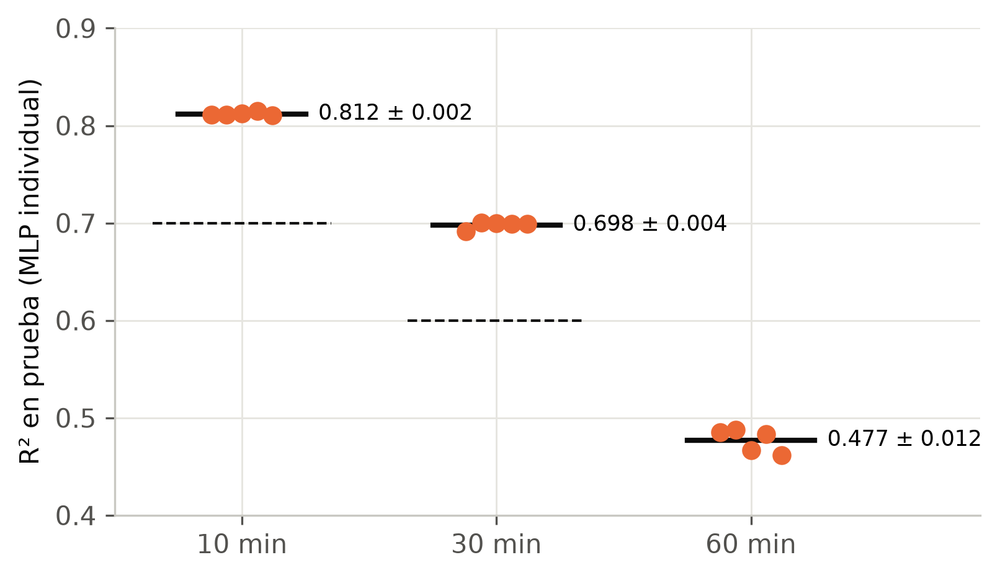

*Figura 14. R² de las cinco MLP individuales (puntos) y su media (línea).*

**Validación por origen móvil (Tabla 6 y Figura 15).** Se reentrenó la red en cuatro trimestres consecutivos, con una sola semilla (versión conservadora).

*Tabla 6. R² por trimestre de prueba.*

| Trimestre de prueba | Red 10 min | Persistencia 10 min | Red 30 min | Persistencia 30 min |
|---|---|---|---|---|
| ago–oct 2022 | 0.867 | 0.637 | 0.734 | −0.374 |
| nov 2022 – ene 2023 | 0.949 | 0.848 | 0.868 | 0.324 |
| feb–abr 2023 | 0.888 | 0.650 | 0.804 | −0.286 |
| may–jul 2023 | 0.801 | 0.500 | 0.684 | −0.461 |
| **Año completo [IC 95 %]** | **0.876 [0.860, 0.888]** | 0.667 | **0.771 [0.747, 0.790]** | −0.153 |

**La red cumple ambas metas en los cuatro trimestres.**

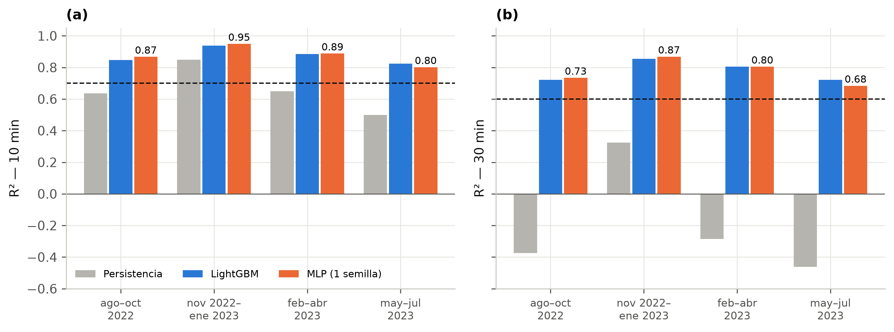

*Figura 15. R² por trimestre en la validación por origen móvil a (a) 10 min y (b) 30 min.*

**Por mes (Figura 16).** Dentro del periodo de prueba, la red supera las metas en cada uno de los cuatro meses.

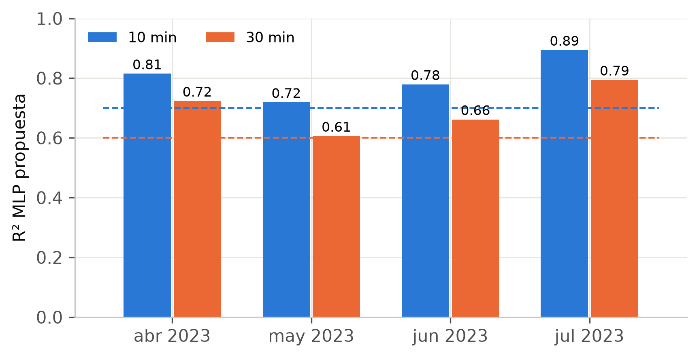

*Figura 16. R² mensual de la red propuesta en el periodo de prueba.*

## 2.7 Efecto de la información de entrada

*Tabla 7. Ablación de la información de entrada (MLP, semilla 42).*

| Información de entrada | N.º variables | R² 10 min | R² 30 min | R² 60 min |
|---|---|---|---|---|
| Solo condiciones actuales | 16 | 0.649 | 0.511 | 0.283 |
| Actuales + reloj de fase | 26 | 0.753 | 0.560 | 0.406 |
| Actuales + reloj de fase + historia | 153 | 0.811 | 0.691 | 0.485 |

La incorporación de información histórica mejora la predicción en todos los horizontes. Con solo las condiciones actuales la red obtiene R² = 0.649 (10 min) y 0.511 (30 min). Al añadir el reloj de fase sube a 0.753 y 0.560, y con la historia del proceso llega a 0.811 y 0.691: **+0.16 y +0.18 de R²** frente a las condiciones actuales (Figura 17).

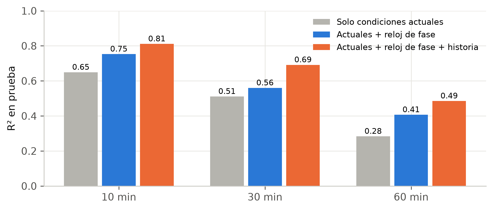

*Figura 17. R² según la información de entrada.*

*Tabla 8. Importancia por permutación agrupada (pérdida de R² del ensamble).*

| Familia de variables | N.º | Pérdida de R² a 10 min | Pérdida de R² a 30 min |
|---|---|---|---|
| Fase y reloj del ciclo | 18 | 0.202 | **0.565** |
| Historia de PO₄ | 63 | 0.191 | **0.519** |
| Caudal y carga hidráulica | 13 | 0.082 | 0.217 |
| O₂ disuelto | 18 | 0.042 | 0.017 |
| PO₄ actual | 1 | 0.020 | 0.030 |
| NH₄ (actual e historia) | 20 | 0.018 | 0.014 |
| Temperatura y calendario | 6 | 0.008 | 0.013 |
| Dosificación química (Fe, PAC) | 14 | 0.005 | 0.005 |

A 30 min, las variables más influyentes son el reloj de fase del ciclo y la historia de PO₄; les sigue el caudal. La dosificación química tiene una influencia mínima en este horizonte.

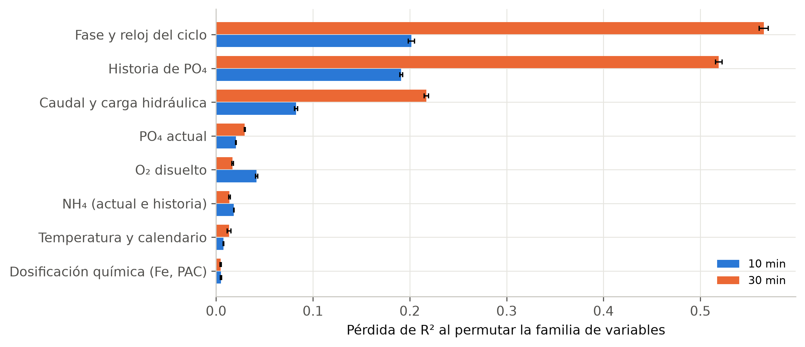

*Figura 18. Importancia de cada familia de variables a 10 y 30 min.*

## 2.8 Análisis de errores y utilidad operativa

**Error según la fase del ciclo (Figura 19).**
- El error de la red es mínimo al inicio del ciclo (RMSE ≈ 0.2 mg/L) y máximo después del 60 % del ciclo (≈ 0.45 mg/L). En ese tramo la duración restante del ciclo, decidida por el controlador de la planta, es incierta.
- La red reduce el error de la persistencia y del modelo mecanístico en todas las posiciones del ciclo.

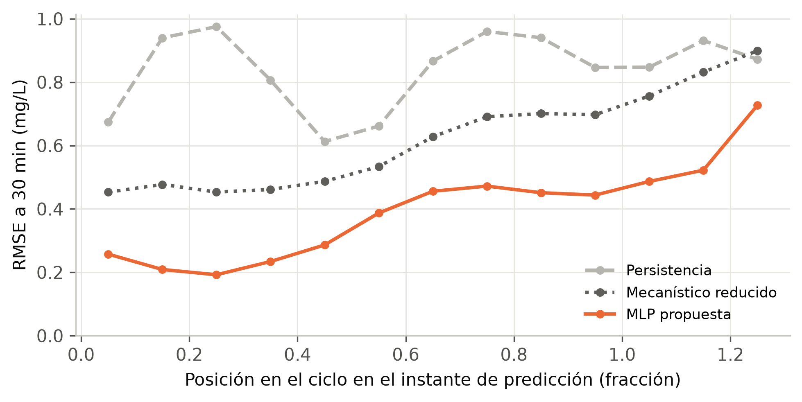

*Figura 19. RMSE a 30 min según la posición en el ciclo en el instante de la predicción.*

**Alerta temprana (Tabla 9, Figura 20).**

*Tabla 9. Alerta de PO₄ > 2 mg/L (5.2 % del periodo de prueba).*

| Modelo | Precisión 10 min | Exhaustividad 10 min | F1 10 min | Precisión 30 min | Exhaustividad 30 min | F1 30 min |
|---|---|---|---|---|---|---|
| Persistencia | 0.59 | 0.59 | 0.59 | 0.28 | 0.28 | 0.28 |
| LightGBM | 0.84 | 0.54 | 0.66 | 0.79 | 0.39 | 0.53 |
| **Red propuesta** | **0.82** | **0.62** | **0.71** | **0.71** | **0.53** | **0.61** |

Con 30 min de anticipación, la red detecta el 53 % de los episodios con un 71 % de alarmas correctas. Su F1 es más del doble que el de la persistencia.

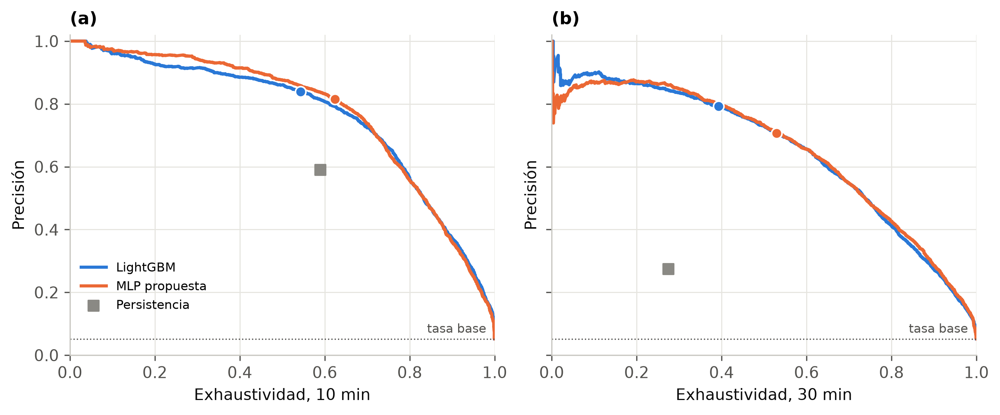

*Figura 20. Curvas precisión–exhaustividad de la alerta de PO₄ > 2 mg/L a (a) 10 min y (b) 30 min.*

**Red neuronal frente a modelo mecanístico (Tabla 10, Figura 21).**

*Tabla 10. Parámetros efectivos del modelo mecanístico reducido.*

| Horizonte | k sin alim. (paso⁻¹) | k alim. (paso⁻¹) | b sin alim. | b alim. | c sin alim. (mg/L) | c alim. (mg/L) |
|---|---|---|---|---|---|---|
| 10 min | 0.043 | 0.044 | 0.82 | 0.43 | 0.12 | 0.46 |
| 30 min | 0.97 | 1.00* | 0.72 | 0.94 | 0.04 | 0.21 |

\* En la cota superior.

- El modelo mecanístico reproduce la forma del ciclo, pero no la amplitud de cada pico.
- A 10 min su constante efectiva (k ≈ 0.043 paso⁻¹) equivale a un tiempo característico de ~46 min.
- A 30 min la tasa satura su cota, lo que indica identificabilidad débil.

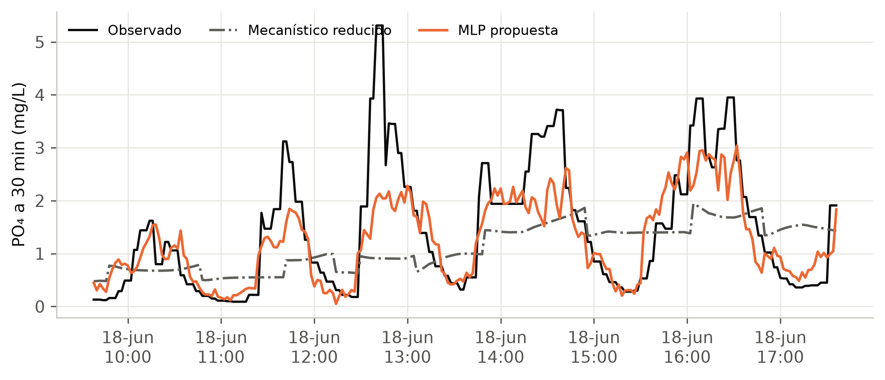

*Figura 21. Predicción a 30 min del modelo mecanístico reducido y de la red propuesta durante varios ciclos.*

---

# 3. Discusión de resultados

La concentración de fosfato en el tanque biológico de una PTAR con operación alternada no es una señal lenta. Oscila con cada ciclo de alimentación: en la presente investigación, el 46.6 % de su varianza ocurrió dentro de cada ciclo. Por eso la persistencia obtuvo un R² negativo (−0.442) a 30 min. Para representar esta dinámica se construyó un "reloj de fase", es decir, variables que indican en qué punto del ciclo se encuentra el reactor y cuánto duraron las fases anteriores. Junto con la historia reciente del proceso, estas variables permitieron a la red neuronal pasar de R² = 0.511 con solo las condiciones actuales a R² = 0.691 a 30 min. Este enfoque difiere del adoptado por Xu et al. (2023), quienes seleccionaron las variables de entrada mediante correlación de Pearson (destacando el caudal afluente, con r = 0.69) y alimentaron una red LSTM con registros previos de fósforo y caudal en ventanas de dos días. Con esa selección estadística obtuvieron R² = 0.496 al predecir la carga de fósforo con un día de anticipación. La diferencia indica que, en procesos con operación cíclica, una ingeniería de variables basada en el conocimiento del proceso aporta información que la correlación lineal no detecta: el valor de PO₄ a 30 min depende de la fase en que estará el reactor, no de la magnitud actual de las variables. Esto concuerda con Cai et al. (2026), quienes atribuyeron la mejora de su modelo GAT-CNN-LSTM a representar explícitamente las relaciones entre variables del proceso. En sus ablaciones, una LSTM sola obtuvo R² = 0.16 para fósforo total, frente a 0.61 al añadir la red de atención sobre grafos.

La arquitectura propuesta, un perceptrón multicapa de tres capas ocultas de 512 neuronas con normalización de capa, activación GELU y dropout de 0.10, alcanzó R² = 0.822 a 10 min y 0.720 a 30 min. En ese horizonte fue estadísticamente equivalente a dos redes secuenciales entrenadas en GPU, una GRU (0.718; p = 0.63) y una TCN (0.711; p = 0.07), y a LightGBM (0.711; p = 0.08). Esto concuerda con lo observado por Cai et al. (2026), donde la mejora no provino de la profundidad temporal de la red sino de cómo se representaron las variables: su LSTM, una arquitectura recurrente diseñada para series temporales, obtuvo apenas R² = 0.16. En la presente investigación, la información temporal relevante se entregó a la red como variables explícitas (rezagos, medias móviles y reloj de fase), lo que permitió que una red de alimentación directa igualara a las recurrentes. Cada MLP entrena entre 8 y 40 veces más rápido que una GRU o una TCN. Xu et al. (2023) reportaron que su red neuronal artificial obtuvo R² = 0.55 por sobreajuste, inferior a su máquina de vectores de soporte (0.637). En el presente trabajo, el sobreajuste se controló con cuatro mecanismos complementarios:
- *dropout*;
- decaimiento de pesos con el optimizador AdamW;
- detención temprana sobre un conjunto de validación cronológico;
- promedio de cinco redes con distinta inicialización.

Este último redujo el error frente a las redes individuales (+0.029 de R² a 30 min; p < 0.001) y mostró una variabilidad entre semillas de solo ±0.004.

La validación del modelo se diseñó para reflejar su uso real en planta: partición cronológica sin mezcla aleatoria, purga de 60 min entre conjuntos, verificación formal de ausencia de información futura e intervalos de confianza por bootstrap de bloques diarios. Dikmen et al. (2025) evaluaron cinco algoritmos de aprendizaje automático (árbol de decisión, bosque aleatorio, *gradient boosting*, XGBoost y LightGBM) sobre 1075 registros diarios de una PTAR de Estambul, con tres métodos de selección de variables y una partición 80/20. Para el fósforo total del efluente, su mejor modelo (LightGBM con SelectKBest) obtuvo R² = 0.287 y MAE = 0.230 mg/L. La red propuesta en la presente investigación obtuvo R² = 0.720 y MAE = 0.213 mg/L a 30 min, y 0.822 y 0.157 mg/L a 10 min. Además se evaluó en un periodo de prueba con un régimen operativo distinto al de entrenamiento: dosificación de PAC casi nula en 2023. En la validación por origen móvil, la red cumplió las metas en los cuatro trimestres evaluados (R² mínimo de 0.801 a 10 min y 0.684 a 30 min), con un R² anual de 0.876 [0.860–0.888] y 0.771 [0.747–0.790]. Esto confirma que el desempeño no depende de un periodo de prueba favorable.

El efecto del horizonte de predicción fue gradual: el R² de la red pasó de ≈0.95 a 2 min a 0.822 a 10 min, 0.720 a 30 min y 0.509 a 60 min, sin pérdidas abruptas. Mohammadi et al. (2024) trabajaron con el mismo sensor de la PTAR de Agtrup. Entrenaron seis arquitecturas profundas (LSTM, Transformer, Informer, Autoformer, DLinear y NLinear) para predecir el PO₄ un paso adelante (2 min), con secuencias de entrada de 8 h y una partición 85/15. Aunque a un paso obtuvieron errores bajos (MSE de 0.0006 a 0.0015), al usar los modelos como simuladores de varios pasos las predicciones se degradaban hasta volverse erróneas por la acumulación del error de cada paso. En un trabajo posterior (Mohammadi et al., 2024b), los mismos autores necesitaron reentrenar con las propias predicciones y modificar la función de pérdida para mitigar ese problema. La red propuesta evita la acumulación de errores porque predice de forma **directa** los cambios a 10, 30 y 60 min con una sola salida multihorizonte, y mantiene R² = 0.720 a 30 min y 0.509 a 60 min en un periodo no visto.

Desde el punto de vista de la ingeniería química, la importancia de las familias de variables es coherente con el funcionamiento del proceso:
- **Fase del ciclo e historia de PO₄** dominan a 30 min (pérdidas de R² de 0.565 e 0.519). Durante la alimentación ingresa fosfato con el agua residual y los organismos acumuladores de polifosfato (PAO) liberan ortofosfato en ausencia de oxígeno. En la fase siguiente lo captan y la concentración desciende. El NH₄ sigue el mismo patrón (Figura 5b), lo que indica que el pico de PO₄ refleja principalmente la entrada de carga afluente.
- **El caudal** es la tercera familia más importante (0.217), porque determina la amplitud de cada pico.
- **La dosificación de hierro y PAC** tiene una importancia mínima (0.005) en este horizonte. El PAC se aplica en el decantador, aguas abajo del sensor, y la precipitación con hierro actúa en escalas de horas a días.
- **El modelo mecanístico reducido** confirma esta interpretación: con solo 6 parámetros reproduce la forma del ciclo (R² = 0.574 a 10 min), con un tiempo característico efectivo de ~46 min. Su desempeño cae a 0.310 a 30 min, porque la amplitud de los picos depende de estados no medidos: el PO₄ afluente y el almacenamiento intracelular de los PAO. La red supera al modelo mecanístico en +0.414 de R² a 30 min (p < 0.001).

En términos operativos, la red detecta con 30 min de anticipación el 53 % de los episodios de PO₄ > 2 mg/L, con un 71 % de alarmas correctas (F1 = 0.61, frente a 0.28 de la persistencia). Xu et al. (2023) también plantearon un sistema de alarma, aunque basado en un clasificador de bosque aleatorio sobre datos diarios. En la presente investigación, la alarma se obtiene directamente de la predicción continua de la red, cada 2 min, y deja media hora para ajustar la aireación, la duración de las fases o la dosificación de hierro.

*Tabla 11. Comparación cuantitativa con estudios previos.*

| Estudio | Planta y datos | Variable predicha | Resolución y horizonte | Método | R² | Otras métricas |
|---|---|---|---|---|---|---|
| Mohammadi et al. (2024), *Eng. Appl. Artif. Intell.* | PTAR de Agtrup (mismo sensor), jun-2021 – ene-2023 | PO₄ del tanque 1 | 2 min; un paso (2 min) y simulación multipaso recursiva | LSTM, Transformer, Informer, Autoformer, DLinear, NLinear | No reportado | MSE 0.0006–0.0015 a un paso; las predicciones multipaso se degradan por acumulación de error |
| Xu et al. (2023), *ACS ES&T Water* | PTAR real (EE. UU.), 9 años | Fósforo efluente | Diaria; 1 día | SVM, OLS, RF, ANN, LSTM | SVM 0.637; ANN 0.55; LSTM 0.496 | LSTM: MSE 0.077 |
| Cai et al. (2026), *Water* | PTAR municipal (China) | Fósforo total efluente | Serie operacional | GAT-CNN-LSTM; ablaciones LSTM y GAT-LSTM | GCL 0.70; GAT-LSTM 0.61; LSTM 0.16 | — |
| Dikmen et al. (2025), *Scientific Reports* | PTAR de Estambul, 1075 días | Fósforo total efluente | Diaria | DT, RF, GB, XGBoost, LightGBM + selección de variables | LightGBM 0.287 | MAE 0.230 mg/L |
| **Presente investigación** | **PTAR de Agtrup, 525 600 registros (2021–2023)** | **PO₄ del tanque 1** | **2 min; predicción directa a 10, 30 y 60 min** | **Ensamble de 5 MLP con reloj de fase; validación cronológica y por origen móvil** | **0.822 (10 min); 0.720 (30 min); 0.509 (60 min)** | **MAE 0.157 / 0.213 mg/L; RMSE 0.293 / 0.368 mg/L (10 / 30 min); r = 0.91 / 0.85** |

En términos de R², la red propuesta supera:
- al mejor modelo de Xu et al. (2023) en +0.185 a 10 min y +0.083 a 30 min, y a su LSTM en +0.224 a 30 min;
- al GAT-CNN-LSTM de Cai et al. (2026) en +0.12 a 10 min y +0.02 a 30 min, y a su LSTM en +0.56;
- al mejor modelo de Dikmen et al. (2025) en +0.43 a 30 min, con un MAE menor (0.213 frente a 0.230 mg/L).

Frente a Mohammadi et al. (2024), que no reportaron R², la red mantiene su desempeño a horizontes de 10 a 60 min, donde sus simuladores recursivos se degradaban.

---

# 4. Conclusiones

1. Se desarrolló un modelo de red neuronal (ensamble de cinco perceptrones multicapa) que predice la concentración de fosfato del tanque biológico con **R² = 0.822 a 10 min y R² = 0.720 a 30 min**. Cumple el objetivo general (R² > 0.70 y > 0.60), con intervalos de confianza al 95 % por encima de ambas metas.
2. El desempeño es robusto. La red cumple las metas en los cuatro trimestres de un año de validación por origen móvil (R² anual de 0.876 y 0.771) y con todas las semillas de inicialización (desviación ≤ 0.004).
3. La red supera de forma estadísticamente significativa a la persistencia, al naive de ciclo previo y al modelo mecanístico reducido (p < 0.001). Reduce el RMSE de la persistencia en un 40 % (10 min) y un 56 % (30 min). A 30 min es equivalente a redes secuenciales GRU y TCN, con menor costo computacional.
4. El desempeño disminuye de forma gradual con el horizonte (0.82 → 0.72 → 0.51 entre 10, 30 y 60 min). Incorporar la historia del proceso y el reloj de fase del ciclo mejora el R² frente a usar solo las condiciones actuales (+0.16 a 10 min y +0.18 a 30 min).
5. La dinámica de corto plazo del fosfato está gobernada por el ciclo de operación alternada. Representarlo explícitamente en las variables de entrada es el factor que más contribuye a la capacidad predictiva.

---

# 5. Referencias

- Cai et al. (2026). A Graph Attention-Enhanced Hybrid Deep Learning Model for Effluent Total Nitrogen and Total Phosphorus Prediction in Municipal WWTPs. *Water*, 18(11), 1381. https://doi.org/10.3390/w18111381
- Dikmen, F., Demir, A., Özkaya, B., Raza, A., Rasheed, J., Asuroglu, T., & Alsubai, S. (2025). AI-driven wastewater management through comparative analysis of feature selection techniques and predictive models. *Scientific Reports*. https://pmc.ncbi.nlm.nih.gov/articles/PMC12259835/
- Mohammadi, E., Stokholm-Bjerregaard, M., Hansen, A. A., Nielsen, P. H., Ortiz-Arroyo, D., & Durdevic, P. (2024). Deep learning based simulators for the phosphorus removal process control in wastewater treatment via deep reinforcement learning algorithms. *Engineering Applications of Artificial Intelligence*. arXiv:2401.12822. https://arxiv.org/abs/2401.12822
- Mohammadi, E., Ortiz-Arroyo, D., Stokholm-Bjerregaard, M., Hansen, A. A., & Durdevic, P. (2024b). Improved Long Short-Term Memory-based Wastewater Treatment Simulators for Deep Reinforcement Learning. arXiv:2403.15091. https://arxiv.org/abs/2403.15091
- Mohammadi, E., et al. (2024c). Wastewater Treatment Plant Data for Nutrient Removal System [Dataset]. Mendeley Data. https://doi.org/10.17632/34rpmsxc4z
- Xu, Y., et al. (2023). Artificial Intelligence-Assisted Prediction of Effluent Phosphorus in a Full-Scale Wastewater Treatment Plant with Missing Phosphorus Input and Removal Data. *ACS ES&T Water*. https://doi.org/10.1021/acsestwater.2c00517

---

## Anexo: índice de figuras

| Figura | Archivo | Contenido |
|---|---|---|
| 1 | `F01_diagrama_metodologia.png` | Diagrama metodológico |
| 2 | `F01b_diagrama_validacion.png` | Protocolo de validación y métricas |
| 3 | `F02_serie_po4_particion.png` | Serie de PO₄ y partición cronológica |
| 4 | `F03_ventana_ciclo_operacional.png` | Ventana de 8 h del ciclo operacional |
| 5 | `F04_perfil_intraciclo.png` | Perfiles intra-ciclo de PO₄, NH₄ y O₂ |
| 6 | `F05_autocorrelacion.png` | Autocorrelación de PO₄ |
| 7 | `F06_condiciones_mensuales.png` | Condiciones operativas mensuales |
| 8 | `F07_curvas_entrenamiento.png` | Curvas de entrenamiento |
| 9 | `F08_comparacion_r2.png` | Comparación de R² entre modelos |
| 10 | `F10_observado_vs_predicho.png` | Observado frente a predicho |
| 11 | `F11_serie_prueba.png` | Serie temporal de prueba |
| 12 | `F12_distribucion_residuos.png` | Distribución de errores |
| 13 | `F09_r2_vs_horizonte.png` | R² frente al horizonte |
| 14 | `F14_robustez_semillas.png` | Variabilidad entre semillas |
| 15 | `F13_backtest_estacional.png` | Validación por origen móvil |
| 16 | `F18_r2_mensual_prueba.png` | R² mensual |
| 17 | `F15_ablacion_entradas.png` | Ablación de entradas |
| 18 | `F16_importancia_familias.png` | Importancia por familias |
| 19 | `F17_error_por_fase_ciclo.png` | Error por fase del ciclo |
| 20 | `F19_alerta_temprana.png` | Alerta temprana |
| 21 | `F20_mecanistico_vs_red.png` | Mecanístico frente a red |
